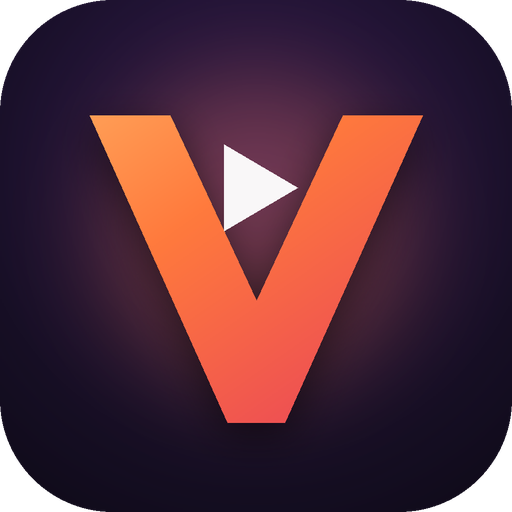

# ولورا فیلم — دانلود اپلیکیشن اندروید

**ولورا فیلم** اپلیکیشن تماشای فیلم و سریال با رابط کاملاً فارسی، دوبله و زیرنویس فارسی و امکان دانلود برای تماشای آفلاین است.

## ⬇️ دانلود

**[دانلود مستقیم Velora.apk (آخرین نسخه)](https://github.com/luciferee6ih/velora-releases/releases/latest/download/Velora.apk)**

یا از بخش [Releases](https://github.com/luciferee6ih/velora-releases/releases) نسخه‌ی دلخواه را انتخاب کنید.

- نسخه: ۱٫۰٫۰
- حداقل اندروید: ۷٫۰ (API 24)
- حجم: حدود ۳٫۴ مگابایت
- SHA-256 فایل: `37e683ba48415a714d0ad1af09acef1646123c72246fa1a24f2aa7eff34ee800`
- اثر انگشت گواهی امضا (SHA-256): `423eb2a89ee93e060954d5f31286ab1527c09bb73fefb378ff75c483890c1b8b`

## نصب
1. فایل **Velora.apk** را روی گوشی دانلود کنید.
2. فایل را باز کنید؛ اگر اندروید اجازه خواست، «نصب از این منبع» را برای مرورگر یا مدیر فایل فعال کنید.
3. «نصب» را بزنید و ولورا را اجرا کنید.

> اگر نسخه‌ی قبلی را با امضای دیگری نصب کرده‌اید، ابتدا آن را حذف کنید. فقط از همین صفحه دانلود کنید؛ نسخه‌های دستکاری‌شده امکان پخش ندارند.

## امکانات
- خانه با اسلایدر، بخش‌های جدیدترین‌ها، برترین‌ها، ژانرها و سریال‌ها
- جستجو و فیلتر بر اساس ژانر، سال، دوبله و زیرنویس
- پخش‌کننده‌ی حرفه‌ای: انتخاب کیفیت، نسخه‌ی دوبله/اصلی، زیرنویس فارسی با تنظیم اندازه و رنگ، ژست‌های نور و صدا، تصویر در تصویر، ادامه‌ی تماشا
- دانلود و تماشای آفلاین
- اشتراک ویژه، علاقه‌مندی‌ها، تاریخچه، درخواست فیلم و اطلاعیه‌ها
- حمایت مالی داوطلبانه از هزینه‌ی سرور

## محتوا
محتوای اولیه شامل فیلم‌های کلاسیک با مالکیت عمومی و آثار Creative Commons (از جمله فیلم‌های باز استودیو بلندر، مانند *Singularity* — (CC) Blender Foundation | studio.blender.org) است.

